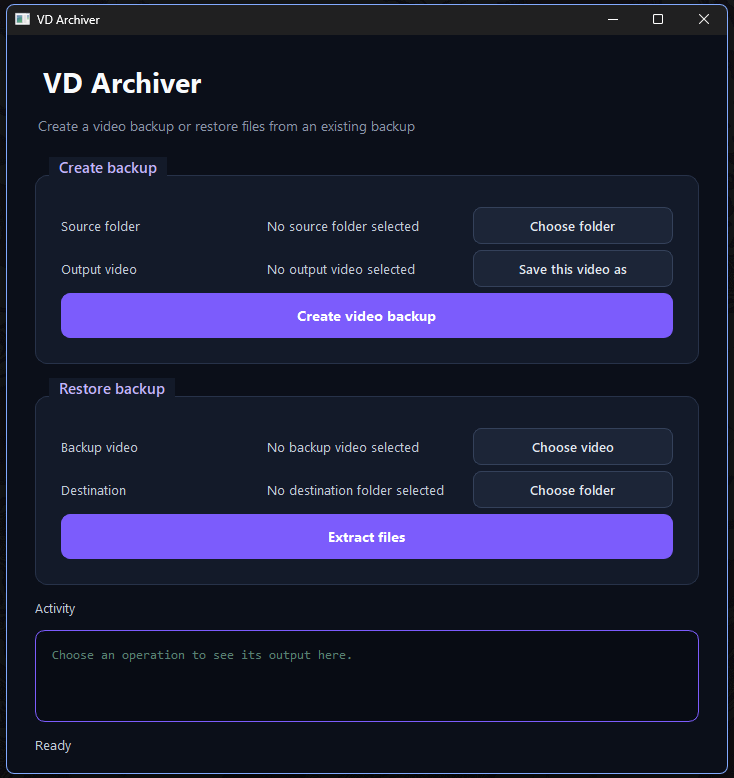

# YT Archiver

**An experimental file backup tool that stores files inside a video.**

YT Archiver is a Python project that converts folders of files into video files for experimental backup and recovery. It splits files into chunks, avoids storing duplicate chunks, verifies data integrity using SHA-256 hashes, and encodes the archive into a Matroska (`.mkv`) video.

It includes a command-line interface (CLI) and a desktop GUI built with PySide6.

## Preview



## Features

- **File chunking** — splits files into manageable pieces.
- **Deduplication** — stores identical chunks only once.
- **Integrity verification** — uses SHA-256 hashes to detect corruption.
- **Video encoding** — packages archive data into an `.mkv` video.
- **File restoration** — reconstructs the original files from a backup video.
- **Two interfaces** — use the desktop GUI or the command line.

## Download

Prebuilt Windows executables are planned to be available through **[GitHub Releases](https://github.com/rdstreem/yt-archiver/releases)**.

Each release is expected to include:

- **`yt-archiver-gui.exe`** — the desktop application.
- **`yt-archiver.exe`** — the command-line application.

Download both executables and keep them in the same folder so the GUI can launch the CLI.

Check the [Releases page](https://github.com/rdstreem/yt-archiver/releases) for published builds.

## How It Works

1. Select a folder to back up.
2. The program splits its files into chunks and identifies duplicates.
3. The chunks and manifest are packaged into an archive.
4. The archive is encoded into an `.mkv` video.
5. To restore the files, the video is decoded, verified, and extracted.

## Getting Started

### Requirements

For running from source:

- Python 3.11 or later
- OpenCV and NumPy
- PySide6 for the desktop GUI

### Installation

Clone the repository:

```bash
git clone https://github.com/rdstreem/yt-archiver.git
cd yt-archiver
```

Install the project and development dependencies:

```bash
pip install -e ".[test,release]"
```

### Launch the GUI

```bash
python -m yt_archiver.ui.app
```

### Use the CLI

Create a video backup:

```bash
yt-archiver archive ./my-files --dest ./backup.mkv
```

Restore files from a video:

```bash
yt-archiver extract ./backup.mkv --dest ./restored
```

Display available commands:

```bash
yt-archiver --help
```

## Building from Source

To build the Windows executables yourself, run the build script from the project root on Windows:

```bat
build_release.bat
```

The executables will be generated in:

```text
dist/release/
├── yt-archiver.exe
└── yt-archiver-gui.exe
```

Keep both executables together when using the GUI build.

## Testing

Run the test suite with:

```bash
pytest
```

## Important Limitations

YT Archiver is an **experimental project**, not a replacement for a reliable backup system.

- In the future, I plan to add integration to youtube so that you get the files to backup on the cloud, however the following still apply.
- Video platforms such as YouTube may re-encode uploaded videos, which can corrupt the encoded data.
- Uploading and downloading a backup through a video platform is not guaranteed to preserve the original data.
- Large archives can require substantial disk space and processing time.
- Always verify restored files and keep another independent copy of important data.

## Project Status

This project is an ongoing experiment in file chunking, deduplication, data integrity, archive formats, and video encoding.
